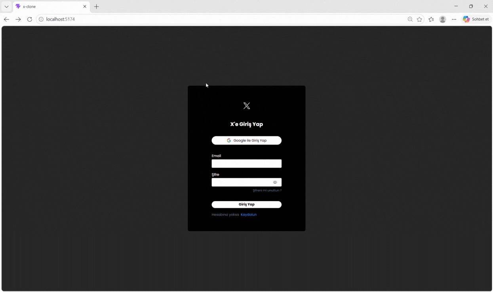

# X Clone

A modern social media application built with **React 19** and **Firebase**, inspired by Twitter (X). Users can share posts, interact with content, upload media, and enjoy a real-time social media experience.

## 🚀 Features

- 📝 Create and share tweets
- ❤️ Like and interact with posts
- 🗑️ Delete tweets
- 🔐 User authentication with Firebase Authentication
- 🖼️ Media and image uploads with Firebase Storage
- 🔥 Real-time data management with Cloud Firestore
- ⏱️ Dynamic timestamps using Day.js
- 🔔 Toast notifications with React Toastify
- 📱 Fully responsive design
- 🧭 Client-side navigation with React Router DOM

## 🎯 Project Purpose

This project was developed to practice building a modern social media application using React and Firebase technologies.

Key learning objectives:

- Implementing real-time post management
- Integrating Firebase Authentication
- Managing media uploads with Firebase Storage
- Handling application data with Cloud Firestore
- Building reusable React components
- Creating responsive user interfaces
- Practicing modern frontend development architecture

## 🛠️ Technologies Used

- **React 19** – Frontend library
- **Vite** – Development and build tool
- **Firebase** – Backend services
- **Firebase Authentication** – User authentication
- **Cloud Firestore** – Real-time database
- **Firebase Storage** – Media storage
- **React Router DOM** – Routing
- **Tailwind CSS v4** – Styling
- **JavaScript (ES6+)** – Programming language
- **React Icons** – Icon library
- **Day.js** – Date and time formatting
- **React Toastify** – Notifications
- **UUID** – Unique identifier generation

## Preview

